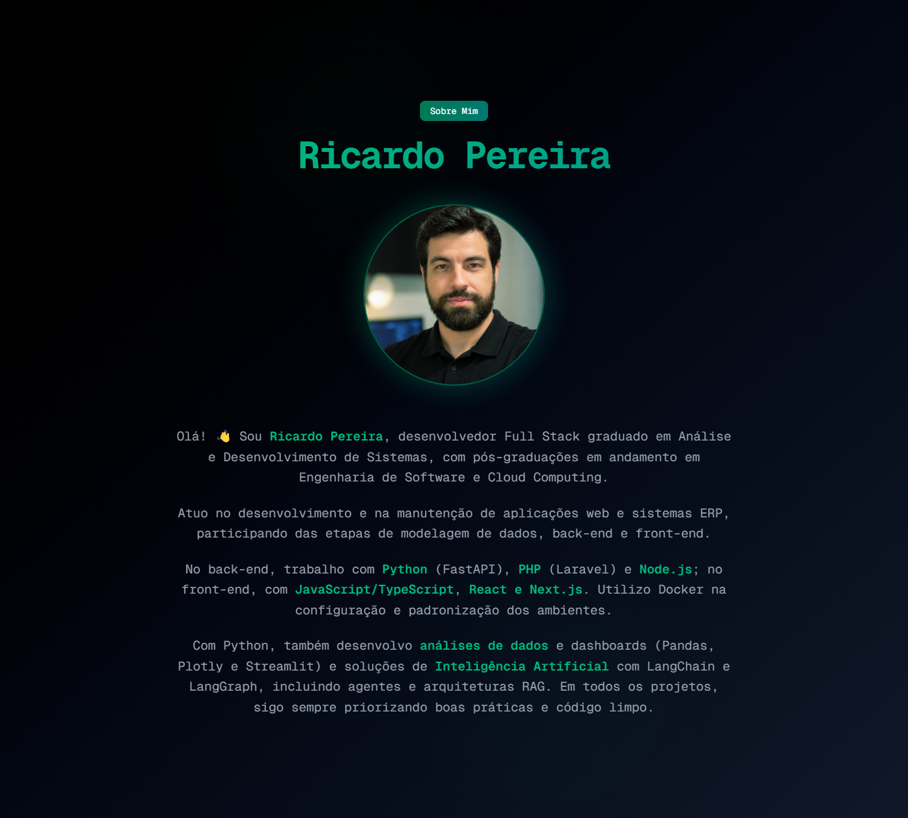
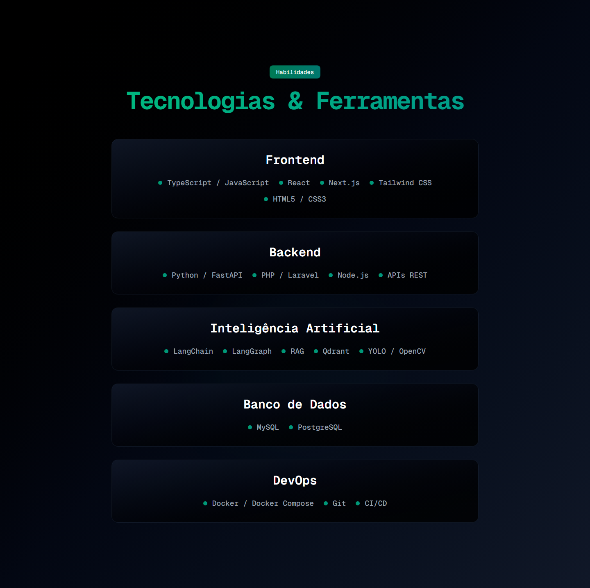
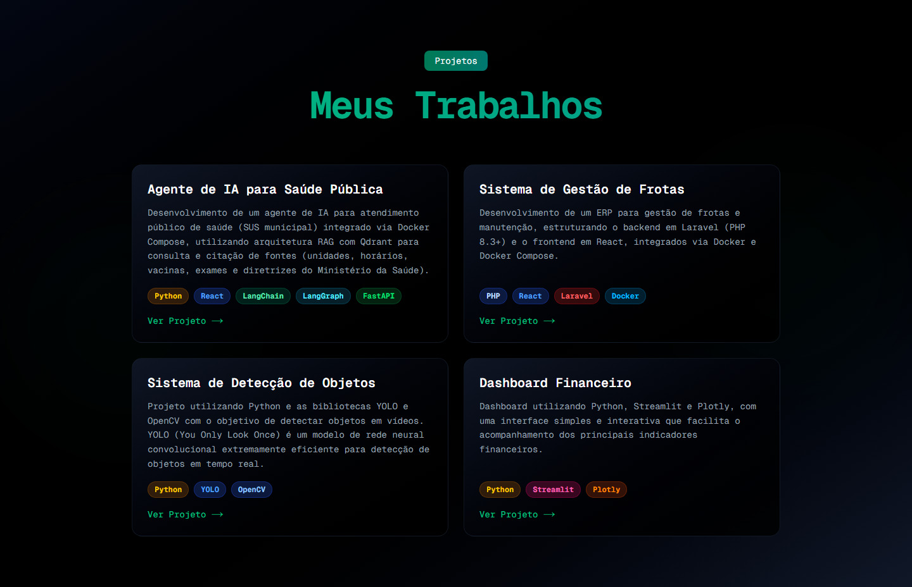
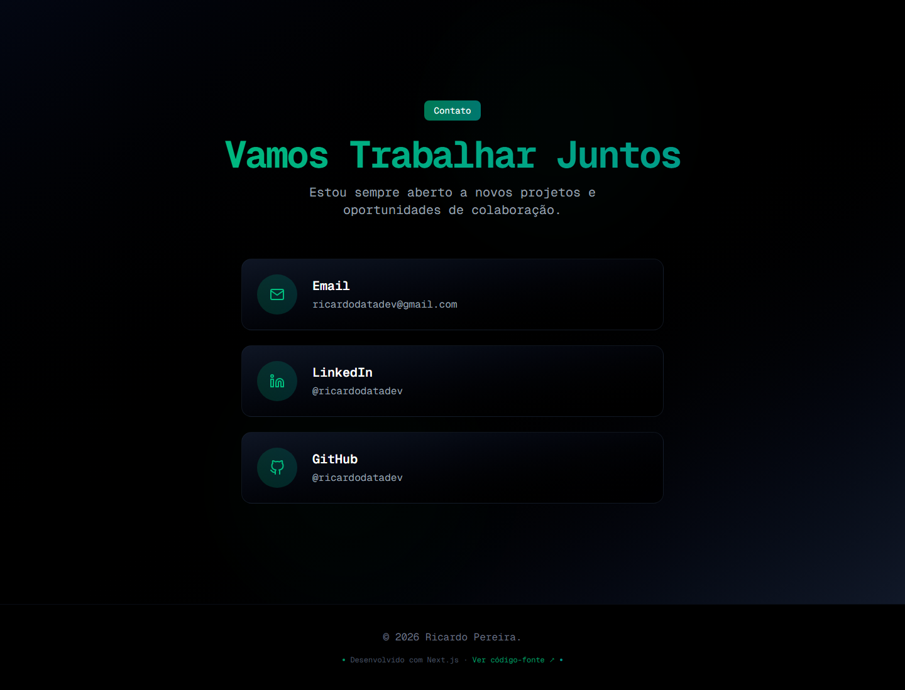
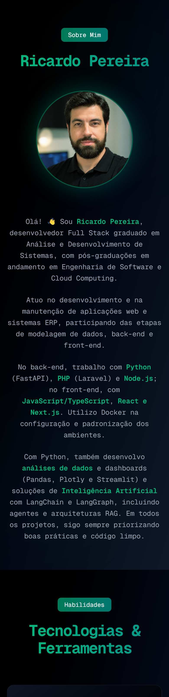

# Portfólio - Ricardo Pereira

Portfólio pessoal moderno e responsivo, desenvolvido com Next.js, React, TypeScript e Tailwind CSS, exportado como site estático.



## 📸 Screenshots

### Habilidades


### Projetos


### Contato


### Versão mobile
<p align="center">
  
</p>

## 🚀 Seções

- **Preloader**: animação de carregamento com barra de progresso
- **Sobre Mim**: apresentação, formação e principais stacks
- **Habilidades**: tecnologias organizadas por categoria (Frontend, Backend, IA, Banco de Dados e DevOps)
- **Projetos**: cards com descrição, tecnologias e link para o repositório
- **Contato**: e-mail, LinkedIn e GitHub
- **Rodapé**: créditos e link para o código-fonte

## 🛠️ Tecnologias

- Next.js 16 (static export)
- React 19
- TypeScript
- Tailwind CSS 4

## 📦 Como executar

```bash
# Instalar dependências
npm install

# Executar em desenvolvimento (http://localhost:3000)
npm run dev

# Gerar o build estático (pasta out/)
npm run build
```

## 🌐 Deploy

O projeto usa `output: "export"`, então o build gera um site 100% estático na pasta `out/`, que pode ser hospedado em qualquer servidor de arquivos (como a Hostinger).

1. Rode `npm run build`
2. Envie o conteúdo da pasta `out/` para a pasta `public_html` do servidor

O arquivo [`public/.htaccess`](public/.htaccess) é incluído no build e configura HTTPS, página 404, cache e compressão.
